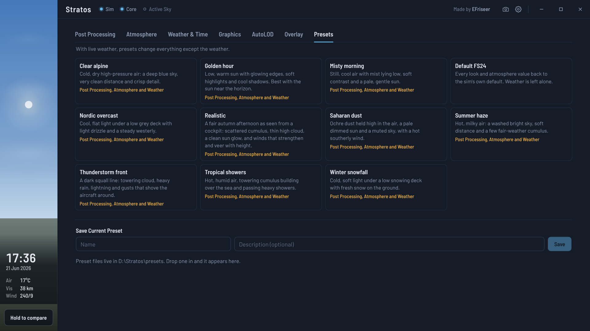
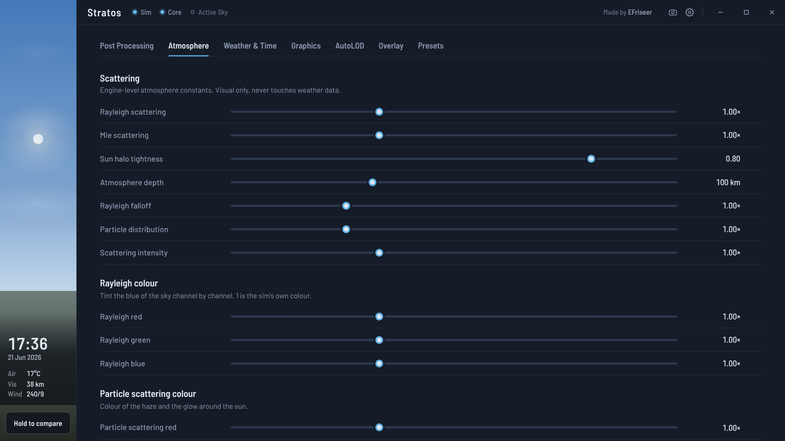
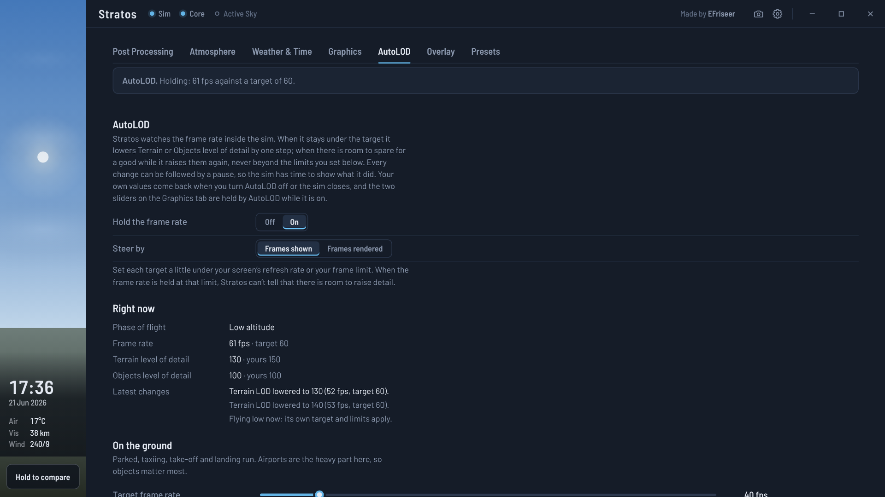
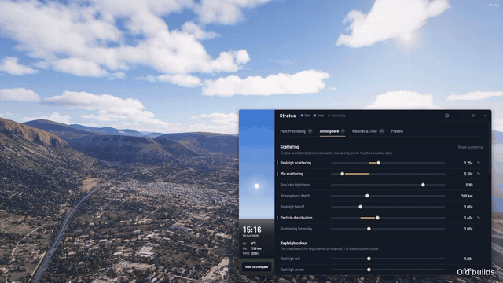
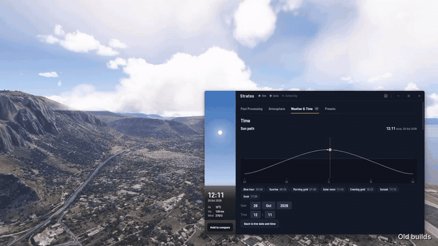
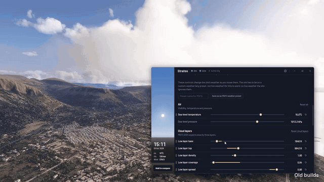
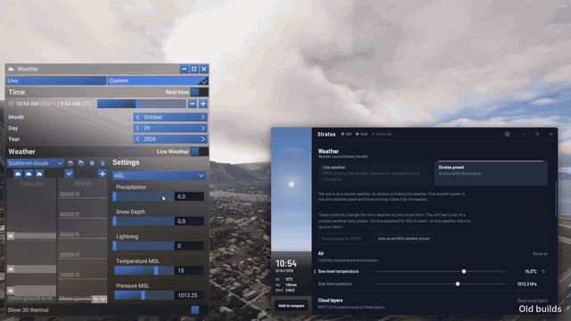
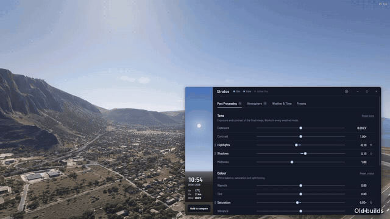

# Stratos

**Live atmosphere, lighting, colour, weather, graphics and AutoLOD control for Microsoft Flight Simulator 2024.**
Every change applies while you fly. No sim restart, no reloading the flight, nothing installed into the sim's folder.

Made by **EFriseer** - [efriseer-games.org](https://efriseer-games.org)

## Download

Stratos is also on **[Flightsim.to](https://flightsim.to/addon/118853/stratos-the-all-in-one-solution)**. Here on GitHub, go to **[Releases](https://github.com/EFriseer/Stratos/releases/latest)** and pick one:

| File | What it is |
|---|---|
| `Stratos_1.0.0_portable.zip` | **Portable.** Extract anywhere and run `Stratos.exe`. Nothing is installed. |
| `Stratos_1.0.0_x64-setup.zip` | **Installer** (zipped). Start menu shortcut, uninstaller, entry in Windows Apps. |

This page itself holds the portable version: `Stratos.exe`, `stratos_core.dll`, `stratos-map.json` and `SimConnect.dll` are the four files the zip contains. Keep them together in one folder.

## What it does

- **Post Processing:** exposure, contrast, highlights, shadows, midtones, warmth, tint, saturation, vibrance, split toning, sharpen, local contrast and vignette. Hold **B** to compare with the untouched sim.
- **Atmosphere:** Rayleigh and Mie scattering, sun halo, atmosphere depth, ozone, sky and haze colours, sun intensity and colour temperature, cirrus.
- **Weather and Time:** sun path with golden hour and blue hour times, direct date and time control, and a Stratos-held weather with three cloud layers, four wind layers with gusts, temperature, pressure, precipitation, lightning and snow depth.
- **Presets:** 11 looks (Clear alpine, Golden hour, Misty morning, Nordic overcast, Realistic, Saharan dust, Summer haze, Thunderstorm front, Tropical showers, Winter snowfall, Default FS24). Save your own, or export weather to the sim's weather list.
- **Graphics:** the sim's own graphics settings (DLSS, FSR, frame generation, Reflex, V-Sync, level of detail, shadows, clouds and more), editable from outside the sim.
- **AutoLOD:** holds your target frame rate by raising and lowering Terrain and Objects level of detail, with separate targets for ground, low and high altitude.
- **Frame counter:** frames shown and rendered, frame time, 1% and 0.1% lows, GPU time and load, and what holds the frame back, drawn over the sim.
- **Screenshots:** one key (Ctrl+Shift+S, works inside the sim) saves a clean PNG with a small Stratos mark.

## Videos

Clips from earlier builds (marked "Old builds"). The previews below are shortened; the full videos can be downloaded from the [`videos`](videos) folder.

**Overview** ([full video](videos/hero-web.mp4))

**Live changes while flying** ([full video](videos/feature-live-changes-web.mp4))

**Weather presets** ([full video](videos/feature-weather-presets-web.mp4))

**Live weather** ([full video](videos/feature-live-weather-web.mp4))

**Standalone app** ([full video](videos/feature-standalone-web.mp4))

## Requirements

- Windows 10 or 11, 64-bit
- Microsoft Flight Simulator 2024 (Steam), DirectX 12
- If the sim runs as administrator, run Stratos as administrator too

## Quick start

1. Download `Stratos_1.0.0_x64-setup.zip` from Releases, extract it and run `Stratos_1.0.0_x64-setup.exe`. It installs for your Windows account only (no administrator rights) and adds a Start menu shortcut and an uninstaller.
2. Windows may show "Windows protected your PC" because the installer is not signed with a paid certificate: click "More info", then "Run anyway".
3. Start Stratos and the sim in any order, load into a flight and wait about ten seconds. Stratos connects by itself.
4. Move a slider or pick a preset.

Prefer no installation? Use `Stratos_1.0.0_portable.zip` instead: extract the whole folder somewhere you can write to (not Program Files, not the sim's folder) and run `Stratos.exe`.

Details on every tab are in the [release notes](https://github.com/EFriseer/Stratos/releases/latest).

## Please read

Stratos has been tested **only on the author's own PC and configuration**. It may not work for you, may look different, or may break after a sim update. Use it at your own risk. See `LICENSE.txt`.

## Support

Join the **[Discord](https://discord.gg/uVhwXbFJGJ)** for help, questions and ideas. Bugs can also be reported as an [issue](https://github.com/EFriseer/Stratos/issues). Please attach `stratos-app.log` and `stratos-core.log` (they are in the Stratos folder) and tell me your GPU, driver version and what you were doing.
